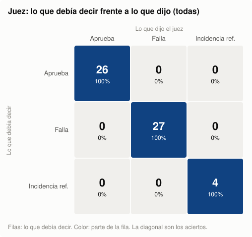

# Diseño experimento de entrenamiento LLM a partir de documentación técnica

Flujo local que convierte la documentación cruda de `docs_raw/` en datasets de entrenamiento y evaluación para un modelo abierto pequeño cuya tarea es responder preguntas técnicas a partir de documentación de software. Cada fila de salida se puede rastrear hasta su archivo y sus líneas de origen.

## Diseño general

**Enfoque: SFT con la recuperación como herramienta.** El modelo no memoriza la documentación: la consulta. Ante una pregunta técnica, llama a la herramienta `obtener_documentacion(software, version)`, que en esta versión es un filtro simple que devuelve los documentos completos. Después lee los documentos y responde citando cada afirmación con su documento y sus líneas. Con SFT (*supervised fine-tuning*) se le enseña esa conducta completa:
- buscar la fuente correcta;
- responder solo con lo que dice la evidencia, citándola (trazabilidad);
- cuando la evidencia no alcanza, decirlo y explicar qué falta, en lugar de inventar.

Por eso cada ejemplo de entrenamiento es una conversación completa: pregunta → llamada a la herramienta con los argumentos correctos → documentos devueltos → respuesta con citas, o aclaración de lo que no se puede responder. Hay un ejemplo real, comentado, en [Un ejemplo de entrenamiento](#un-ejemplo-de-entrenamiento).

**Por qué SFT y no *continued pretraining* (CPT).** El CPT entrena al modelo a predecir el texto de la documentación para que la absorba como conocimiento. Aquí eso no sirve, por cuatro razones:
- La documentación cambia y tiene versiones: el conocimiento memorizado queda viejo y mezcla versiones.
- Lo memorizado no se puede citar ni rastrear hasta una línea.
- No enseña a decir «no está documentado».
- No sirve para software que el modelo nunca vio.

Lo que hay que enseñar es una conducta (consultar, leer, citar y abstenerse cuando corresponde), y eso se supervisa con SFT sobre conversaciones. El conocimiento llega en el momento de responder, por la herramienta. Así el mismo modelo sirve para documentación nueva o desconocida, que es la condición para escalar a millones de documentos.

**Modelo: Qwen3.5-4B.** Es abierto (Apache 2.0) y pequeño (4.000 millones de parámetros), admite 262.144 tokens de contexto (nuestras conversaciones llegan a ~23.000) y su plantilla de chat soporta llamadas a herramientas. Para probar el entrenamiento sin GPU se usa `tiny-Qwen3_5ForConditionalGeneration-Think`, un modelo de prueba de Hugging Face (`trl-internal-testing`). Tiene la misma arquitectura, la misma plantilla de chat y el mismo vocabulario que el 4B, pero solo 2 capas y pesos aleatorios. No aprende nada útil, pero da un paso de entrenamiento real en CPU y comprueba que los datos, la máscara de pérdida y la configuración funcionan de punta a punta.

**El flujo, fase por fase:**

| Fase | Qué hace |
|---|---|
| 0. Auditoría | Parte toda la documentación en secciones y decide cuáles son fiables. Hay chequeos automáticos, y dos LLM de proveedores distintos: uno clasifica cada sección (usable, parcial o no usable, con el motivo: inconsistencias, contenido roto o incompleto, documentación que se anuncia y falta) y el otro revisa esa clasificación. Donde discrepan, decide una persona |
| 1. Catálogo y contrato | Normaliza cada documento sin mover ninguna línea, para que las citas sigan apuntando al original: decodifica entidades HTML (`&gt;` → `>`), quita marcas de docsify e insignias, y oculta datos personales. Cada cambio queda registrado y se puede deshacer. Además excluye los archivos de navegación, marca las copias idénticas entre versiones por hash y clasifica cada documento por tipo de evidencia (texto, tabla, código, diagrama, OpenAPI, fórmula), para saber qué tipos de pregunta admite. También fija las reglas de los ejemplos |
| 2. Separación | Reparte cada software entero en train, validation o test. Así ningún software aparece en dos conjuntos, la evaluación se hace sobre documentación que el modelo nunca vio, y cada conjunto tiene todos los tipos de contenido |
| 3. Generación | Un LLM escribe los ejemplos de 10 situaciones: con evidencia suficiente, parcial o nula, con contradicciones, sin software o sin documentos. El código comprueba el formato y las citas mientras se generan, y otro LLM de otro proveedor verifica cada caso con la rúbrica de evaluación |
| 4. Validación y exportación | Repite los controles, elimina casi duplicados, aplica la revisión humana y exporta los datasets en el formato del `SFTTrainer` de Hugging Face |
| 5. Experimento | Define B0 (el modelo sin ajustar), E1 (SFT con todos los ejemplos) y E2 (una ablación) |
| 6. Evaluación | Las reglas deterministas comprueban la recuperación y las citas: si llamó a la herramienta con los argumentos correctos, si recibió los documentos esperados y si las citas son válidas. Un LLM juez evalúa la calidad de la respuesta. Antes de usarlo se lo calibra: un LLM «corruptor» fabrica respuestas con errores conocidos (y paráfrasis correctas), y se mide si el juez las distingue |
| 7. Escalado | Qué cambia para procesar millones de documentos |

**La ablación (E2).** E2 se entrena **sin** los ejemplos de evidencia parcial o sin evidencia, pero se evalúa con el mismo conjunto completo que E1, que sí incluye esos casos. Así se mide qué aportan: si, al no haberlos visto, el modelo inventa respuestas donde debería decir que no puede responder. E2 ve el mismo número de ejemplos que E1, para que la diferencia no se deba al volumen.

**Escalabilidad.** El diseño piensa en millones de documentos: claves estables por hash, reanudación, controles baratos antes de cualquier LLM y verificación por lotes. No todo escala tal cual: la fase 7 detalla qué habría que cambiar.

Este fue el diseño que planteé; los scripts, los documentos generados y los tests fueron creados con [Claude Code](https://claude.com/claude-code).

## Estructura del repositorio

```
docs_raw/          Documentación cruda de entrada (no se modifica)
src/               Todo el código del flujo
  llm.py             Capa única para llamar a los LLM (CLI o API)
  check_setup.py     Verificación del entorno
  fase0/             Fase 0: auditoría de la documentación
  fase1/             Fase 1: catálogo, herramienta y contrato de los ejemplos
  fase2/             Fase 2: separación en conjuntos
  fase3/             Fase 3: generación y verificación de los ejemplos
  fase4/             Fase 4: validación y exportación de los datasets
  fase5/             Fase 5: diseño del experimento (configuración y comprobaciones)
  fase6/             Fase 6: juez, calibración y evaluación
  utils/             Herramientas para inspeccionar resultados
  tests/             Tests deterministas
model_data/        Copia de los conjuntos finales (train, validation y test), para revisarlos fácilmente
data/              Todas las salidas del flujo, incluidas las estadísticas de cada fase en data/reportes/ (se suben al repositorio)
reports/           Presentación del proyecto (presentacion.pptx)
docs/              Explicación detallada de cada fase y sus decisiones
requirements.txt   Dependencias de Python, con versiones fijas
requirements-entrenamiento.txt   Dependencias extra solo para entrenar (PyTorch, TRL, PEFT, datasets)
.env.example       Plantilla de las variables de entorno (LLM y API keys)
```

`model_data/` es solo una copia de `data/fase4/{train,validation,test}.jsonl` (211, 97 y 78 conversaciones), para que los conjuntos finales se puedan revisar sin recorrer el flujo. El flujo no la usa: cada fase sigue leyendo de `data/` y escribiendo en su carpeta. Si se vuelve a ejecutar la fase 4, la copia se actualiza con `cp data/fase4/{train,validation,test}.jsonl model_data/`.

## Requisitos

- **Python 3.10 o superior.** Comprueba tu versión con `python3 --version`.
- **Para reproducir los resultados entregados no hace falta ningún LLM.** Todas las respuestas de los LLM están guardadas en el repositorio, y cada fase se vuelve a ejecutar desde esa caché, sin sesión ni API keys (ver «Reproducir y verificar los resultados»).
- **Para volver a generar con LLM** (por ejemplo, tras cambiar un prompt), hace falta acceso a un modelo de **Anthropic** y a uno de **OpenAI**. Cada tarea que usa un LLM tiene su propia configuración. Cada modelo se puede usar de dos formas; elige la que tengas:

| Proveedor | Con tu sesión (sin API key) | Con API key |
|---|---|---|
| Anthropic | [Claude Code](https://docs.claude.com/en/docs/claude-code) — backend `claude_code` | `ANTHROPIC_API_KEY` — backend `anthropic_api` |
| OpenAI | [Codex CLI](https://github.com/openai/codex) — backend `codex` | `OPENAI_API_KEY` — backend `openai_api` |

  Las dos formas usan el mismo modelo; solo cambia cómo te autenticas.

## Configuración

Todos los comandos se ejecutan desde la raíz del repositorio.

### 1. Clonar el repositorio

```bash
git clone <url-del-repositorio>
cd <carpeta-del-repositorio>
```

### 2. Crear y activar un entorno virtual

El entorno virtual usa la versión de Python con la que lo crees. Si `python3 --version` muestra una versión anterior a 3.10, crea el entorno con un intérprete más nuevo. 

macOS / Linux:

```bash
python3 -m venv .venv
source .venv/bin/activate
```

Windows (PowerShell):

```powershell
python -m venv .venv
.venv\Scripts\Activate.ps1
```

Con el entorno activado, el prompt de la terminal empieza por `(.venv)`. A partir de aquí, `python` y `pip` se refieren a los del entorno virtual.

### 3. Instalar las dependencias

```bash
pip install --upgrade pip
pip install -r requirements.txt
```

| Paquete | Para qué se usa |
|---|---|
| `anthropic` | Los LLM configurados con el backend `anthropic_api` |
| `openai` | Los LLM configurados con el backend `openai_api` |
| `python-dotenv` | Leer la configuración de `.env` |
| `pyyaml` | Validar los `swagger.yaml` de la documentación |
| `pytest` | Ejecutar los tests |
| `transformers`, `jinja2` | Fase 4: plantilla de chat y tokenizer de Qwen3.5 para medir las conversaciones en tokens (no instala PyTorch ni descarga los pesos del modelo) |

### 4. Configurar los LLM

```bash
cp .env.example .env
```

Abre `.env` con cualquier editor y elige el backend del LLM de cada tarea. Cada tarea tiene su propia configuración y ninguna toma la de otra:

```
LLM_CLASIFICADOR_BACKEND=claude_code   # fase 0: clasifica cada sección
LLM_VALIDADOR_BACKEND=codex            # fase 0: valida cada clasificación
LLM_GENERADOR_BACKEND=claude_code      # fase 3: genera las conversaciones candidatas
LLM_VERIFICADOR_BACKEND=codex          # fase 3: verifica cada candidato
LLM_CORRUPTOR_BACKEND=claude_code      # fase 6: escribe respuestas con errores deliberados para calibrar al juez
LLM_JUEZ_BACKEND=codex                 # fase 6: evalúa las respuestas del modelo
```

Los backends posibles son `claude_code`, `codex`, `anthropic_api` y `openai_api`. Las variables `LLM_<TAREA>_MODEL` pueden quedar vacías para usar los modelos por defecto.

**Si usas un backend de sesión** (`claude_code` o `codex`), instala la CLI e inicia sesión una vez. Requiere [Node.js](https://nodejs.org/) 18 o superior:

```bash
# Claude Code
npm install -g @anthropic-ai/claude-code
claude          # inicia sesión con tu cuenta y sal con /exit

# Codex
npm install -g @openai/codex
codex login
```

El flujo llama a estas CLIs sin herramientas y en una carpeta temporal vacía: no leen ni modifican tus archivos. Además, quita las API keys del entorno al llamarlas, para que siempre usen tu sesión y no te cobren por API. Las llamadas cuentan contra los límites de tu suscripción.

**Si usas un backend de API** (`anthropic_api` u `openai_api`), pega la clave correspondiente después del `=`, sin comillas ni espacios:

```
ANTHROPIC_API_KEY=sk-ant-...
OPENAI_API_KEY=sk-...
```

Solo hace falta la clave de los backends `*_api` que elijas. `.env` está en `.gitignore`, así que tus claves no se suben al repositorio.

### 5. Verificar la configuración

```bash
python -m src.check_setup
```

Este comando no llama a ningún LLM ni consume saldo. Comprueba:

- la versión de Python;
- que las dependencias estén instaladas;
- que exista `docs_raw/`;
- para cada LLM, lo que necesita su backend: la CLI instalada con sesión iniciada, o la API key definida.


Para confirmar que todos los LLM responden, haz una llamada mínima real a cada uno. Tarda unos segundos y consume muy pocos tokens:

```bash
python -m src.check_setup --ping
```


Si algo falla, cada línea `[error]` indica qué falta y cómo corregirlo.

## Fase 0 — Auditoría de la documentación

Antes de generar datos de entrenamiento hay que saber qué parte de la documentación es fiable. La fase 0 parte toda la documentación en secciones y las etiqueta **todas**, sin excepciones:
- **Estado:** `usable`, `parcial` o `no_usable`. Una sección es usable si de ella se pueden sacar pares pregunta-respuesta cuya respuesta está en el propio texto y es fiable.
- **Categoría:** endpoint, configuración, procedimiento, etc.

También registra qué partes anuncia la documentación sin llegar a cubrirlas. Las fases siguientes solo generan datos a partir de las secciones `usable` y `parcial`.

La clasificación la hacen dos LLM de proveedores distintos: **A** clasifica cada sección y **B** revisa cada clasificación de A. Cuando dan estados distintos, una persona elige cuál de los dos criterios usar.

### 1. Ejecutar la auditoría

```bash
python -m src.fase0.run
```

Ejecuta todos los pasos hasta generar el archivo de revisión humana:
1. Inventario de archivos, partición en secciones y chequeos automáticos (sin LLM).
2. El LLM clasificador (A) clasifica cada sección.
3. El LLM validador (B) revisa cada clasificación de A.
4. Se escribe `data/fase0/human_review.csv` con las secciones en las que A y B dan estados distintos.

Cada respuesta de los LLM se guarda en `data/cache/`, que está en el repositorio. Por eso, con los resultados entregados, este comando **no llama a ningún LLM**: reutiliza las respuestas guardadas y no necesita sesión ni API key.

### 2. Revisar el CSV

Abre `data/fase0/human_review.csv` con Excel o cualquier hoja de cálculo. Cada fila es una sección en la que A y B discrepan, con:
- su contenido;
- el criterio de A: estado, categoría, justificación y problemas citados;
- el criterio de B: estado, categoría, explicación y cita.

En la columna `decision`, escribe **`A`** o **`B`**, el criterio que te parezca correcto, y guarda el archivo. La sección toma la etiqueta completa del modelo elegido.

Puedes dejar filas vacías. Al finalizar, se completan por defecto: gana el modelo que eligió `parcial`; si ninguno lo eligió, el que eligió `usable`. Criterio para esto: (Conservar las secciones usables en mayor grado posible sin descartar posibles errores o incosistencias encontradas)

### 3. Finalizar la fase

```bash
python -m src.fase0.finalize
```

Aplica las decisiones, verifica que todas las secciones tengan una etiqueta final válida (si no, termina con error) y escribe:

| Archivo | Contenido |
|---|---|
| `data/fase0/section_status.jsonl` | **Resultado de la fase 0.** Etiqueta final de cada sección, con su procedencia (archivo y líneas), su estado, su categoría y, si es `parcial`, las afirmaciones que no se deben usar. |
| `data/fase0/gaps.jsonl` | Partes que la documentación anuncia y no cubre. |
| `data/reportes/fase0/estadisticas.md` | Estadísticas principales de la fase. |

El detalle de cada paso, los prompts, las reglas y el significado de cada archivo están en **[docs/fase0.md](docs/fase0.md)**.

## Fase 1 — Catálogo, herramienta y criterios de los ejemplos

El asistente que se va a entrenar no recibe fragmentos elegidos de antemano. Ante una pregunta técnica, **llama a la herramienta `obtener_documentacion(software, version)`**, que devuelve los **documentos completos** de ese software (de todas sus versiones si `version` es `null`), y responde citando `[documento:Linicio-Lfin]`. La fase 1 deja listo todo lo necesario para generar esas conversaciones, sin generar todavía ninguna:

1. **Catálogo.** Un documento por archivo de `docs_raw`, con su contenido normalizado (sin mover ninguna línea, para que las citas apunten al original), sus hashes y los tipos de evidencia que contiene (texto, tabla, código, diagrama, especificación OpenAPI, fórmula).
2. **Restricciones.** Lo que la fase 0 marcó como no fiable (secciones no usables, afirmaciones excluidas y contradicciones), se convierte en rangos de líneas de cada documento. El modelo recibe los documentos completos, pero los ejemplos no pueden citar esas líneas, y la validación lo comprueba por código.
3. **Herramienta.** El filtro exacto por software y versión, sin búsqueda semántica.
4. **Contrato.** El prompt de modelo a entrenar (prompt de sistema), las reglas, el formato de la conversación de entrenamiento y del caso de evaluación, y 10 conversaciones de referencia escritas a mano. 

**Decisión: los archivos de navegación quedan fuera del catálogo.** `_sidebar.md`, `_coverpage.md` y `documentationTypes.json` (33 de los 107 archivos) son índice, portada y metadatos de docsify. La fase 0 los clasificó como navegación, no contienen evidencia técnica y ocuparían contexto en cada llamada. El catálogo tiene 74 documentos.

### Criterios para crear los ejemplos

- **La fase 0 decide de qué se crean ejemplos, no qué ve el modelo.** La herramienta siempre devuelve los documentos completos, como en el uso real. Las preguntas y respuestas objetivo, en cambio, solo pueden apoyarse en secciones `usable` o `parcial`, y nunca en sus afirmaciones excluidas.
  - **Única excepción, la situación «contradicción»:** Cita las líneas en conflicto para señalarlo, nunca como un hecho.
  - **Documentos idénticos en varias versiones:** Una línea es no citable si lo es en cualquiera de las copias (Evitar duplicidades).
- **Diez situaciones o escenarios que cubrir:**
  - versión explícita;
  - sin versión;
  - «¿en qué versión…?»;
  - comparación de versiones;
  - falta el software (se pregunta por él, sin llamar a la herramienta);
  - software ya indicado en un turno anterior;
  - evidencia parcial;
  - sin evidencia;
  - contradicción;
  - versión o software sin documentos.

  Los huecos de la fase 0 son la fuente de los casos sin evidencia completa, y sus contradicciones, la de los conflictos. Esto se analizó con el primer LLM, el cual sugiere estos hallazgos de documentación faltante.
- **Llamada:** la versión solo se agrega si la pregunta la nombra. En las preguntas como: "¿en qué versión?", en las comparaciones y cuando no se indica versión, se pone `null`.
- **Respuesta:**
  - usa solo los documentos devueltos;
  - cita cada afirmación técnica;
  - no mezcla versiones;
  - distingue «no está documentado» de «no se soporta»;
  - responde lo que tiene respaldo y declara lo que falta.
- **Idioma:** la mayoría de las preguntas en español y una parte en inglés. La respuesta va en el idioma de la pregunta. Esto para ver un poco el comportamiento del modelo en multilenguaje. 

Las reglas completas están en [src/fase1/contract/reglas.md](src/fase1/contract/reglas.md).

### Ejecutar la fase

Requiere la fase 0 terminada.

```bash
python -m src.fase1.run
```

| Archivo | Contenido |
|---|---|
| `data/fase1/catalogo.jsonl` | Un documento por línea: contenido canónico, hashes, transformaciones y tipos de evidencia por líneas. |
| `data/fase1/restricciones.jsonl` | Por documento: líneas no citables, afirmaciones excluidas y conflictos. |
| `data/fase1/huecos.jsonl` | Huecos confirmados por software/versión, con sus líneas. |
| `data/fase1/llamadas.jsonl` | Cada llamada posible a la herramienta, con sus documentos y su tamaño estimado en tokens. |
| `data/fase1/ejemplos_referencia.jsonl` | Las 10 conversaciones de referencia (una por situación), validadas contra el contrato. |
| `src/fase1/contract/` | Prompt de sistema, reglas y esquemas de la conversación y del caso de evaluación. |
| `data/reportes/fase1/estadisticas.md` | Estadísticas de la fase. |

El detalle de cada paso está en **[docs/fase1.md](docs/fase1.md)**.

## Fase 2 — Separación en conjuntos

Antes de generar preguntas, se reparte cada software completo, con todas sus versiones, en **entrenamiento**, **validación** o **prueba**. Así la evaluación se hace sobre documentación que el modelo nunca vió al entrenar. 

**Criterio.** Lo importante es que en cada conjunto se puedan plantear **los mismos tipos de pregunta**. Cuántas de cada tipo se balancea en la fase 3. El criterio tiene dos niveles:

1. **Mínimo obligatorio.**
   - **En los tres conjuntos:** tablas, código, diagramas, OpenAPI, huecos, conflictos y algún software con varias versiones.
   - **Excepciones:**
     - no se exige lo que aparece en menos de 3 software, pues no podria repartirse en los tres conjuntos. 
2. **Objetivo.** Entre los repartos que cumplen el mínimo, el más cercano a 60/20/20 en secciones aprovechables. 

**Resultado:**

| Conjunto | Software | Secciones |
|---|---|---:|
| `train` | vendor-stockkeeper, payment-promise, zenith-keeper, demand-forecast, order-workflow | 56% |
| `validation` | catalog-portfolio, price-engine | 24% |
| `test` | traffic-gate, 2p-revenue, unified-transaction-configs | 19% |

No se llega al 60/20/20 exacto porque cada software va entero y algunos son muy grandes: catalog-portfolio por sí solo es el 21% del material.

```bash
python -m src.fase2.run
```

| Archivo | Contenido |
|---|---|
| `data/fase2/splits.json` | Asignación, perfil de cada software, cobertura y documentos de cada conjunto |
| `data/reportes/fase2/estadisticas.md` | Tipos de pregunta que permite cada conjunto, cobertura y fugas entre conjuntos |

El detalle está en **[docs/fase2.md](docs/fase2.md)**.

## Fase 3 — Generación de los ejemplos

Se generan las conversaciones **candidatas** de `train`, `validation` y `test`, cada una con su caso de evaluación: llamada esperada, documentos esperados, respuesta de referencia con citas y `answer_checks` para el juez. Esto último es una especie de "guia" o "referencia" para que el juez que se va a usar como evaluador, tenga una rúbrica sobre la que evaluar, con respecto las preguntas hechas. 

**Cuántos y de qué tipo.**
- **Tamaño:** 2 casos por sección aprovechable, es decir 232, 100 y 80.
- **Escenarios:** la misma mezcla en los tres conjuntos (responder 45%, versiones 15%, falta información 20%, contradicción 8%, sin llamada o sin documentos 12%).
- **Idioma:** 20% en inglés.
- **Semillas:** cada caso sale de una sección, un hueco o un conflicto real de un software de su conjunto.
- **Argumentos:** los de la llamada los decide el programa según la situación, no el LLM.

**Cómo se genera, por rondas (máximo 3):**
1. **Generador** (`LLM_GENERADOR_*`): recibe la salida real de la herramienta y escribe la pregunta, la respuesta con citas y los `answer_checks`.
2. **Código:** comprueba las reglas de la fase 1 y que la pregunta nombre (o no) el software y la versión según la situación. Si algo falla, el error vuelve al generador.
3. **Verificador** (`LLM_VERIFICADOR_*`, otro proveedor): aplica la rúbrica de la evaluación a grupos o lotes de preguntas (Para evitar sobre costo por tokens de entrada en cada validación).
4. **Decisión:** la toma el programa. Un caso se aprueba solo si cumple todos los criterios. Si no, vuelve al generador con el motivo del rechazo.

**Resultado.**
- **407 candidatos de 412 tareas.** Los 5 omitidos tienen su motivo; en 4 de ellos, la semilla no permitía un caso válido.
- **Llamadas:** 464 al generador y 56 al verificador.
- **Rechazos del verificador:** 9%.

```bash
python -m src.fase3.run --piloto   # prueba: el primer caso de cada situación de train
python -m src.fase3.run            # corrida completa (usa la caché; solo llama por lo que falte)
```

| Archivo | Contenido |
|---|---|
| `data/fase3/candidatos.jsonl` | Conversación, caso de evaluación y veredicto de cada candidato |
| `data/fase3/generation_log.jsonl` | Cada llamada al generador y al verificador, incluidos los rechazos |
| `data/fase3/coverage_report.json` | Cuotas y resultados por conjunto y situación, y uso de cada sección |
| `data/reportes/fase3/estadisticas.md` | Resultado por situación, idioma, tipo de evidencia y calidad del generador |

Para ver ejemplos al azar, con las citas resueltas contra el documento: `python -m src.utils.show_example --conjunto test` (filtros por situación, idioma, software, tipo de evidencia, texto o casos rechazados; ver `--help`).

Los candidatos todavía no son el dataset final. En la fase 4 se eliminan duplicados, se hace la revisión humana, se miden las longitudes en tokens y se exportan. El detalle está en **[docs/fase3.md](docs/fase3.md)**.

## Fase 4 — Validación y exportación

Se validan los candidatos de la fase 3 y se exportan los datasets finales. Es determinista y no usa LLM.

**Modelo a ajustar: Qwen3.5-4B.** Solo se descarga el tokenizer, en una revisión fija, para renderizar cada conversación con su plantilla de chat y medirla en tokens. Al renderizar se aplican dos ajustes:
- `version: null` se escribe como `null`, para que el parser de llamadas de Qwen lo lea como nulo;
- se desactiva el modo de razonamiento (`enable_thinking=False`). Pues no se crearon ejemplos para este escenario. 

Los datos canónicos no cambian.

**Pasos:**
1. **Controles:** Reglas de la fase 1, citas resueltas hasta el catálogo con su hash, aislamiento (ningún caso recibe documentos de otro conjunto, esto para validar en batches), presupuesto de tokens y máscara de función de pérdida o loss (solo se entrenan la llamada y la respuesta).
2. **Duplicados:** Dentro de cada conjunto y situación, los casos que piden el mismo contenido. Típicamente salen de una sección idéntica en dos versiones. La regla se calibró revisando a mano todos los pares candidatos.
3. **Revisión humana** De validation y test, en `data/fase4/revision_humana.csv`. Con `python -m src.fase4.revisar --conjunto test` se recorren los casos pendientes uno a uno, con sus citas resueltas, y cada decisión se guarda al momento. En esta entrega se aprobaron en bloque como ejercicio del flujo, así que las referencias cuentan como verificadas por el LLM, no por una persona. La idea aqui es que se verifique que los datos de validación sean consistentes de acuerdo al ejercicio pretendido, pasando por verificación humana. 
4. **Exportación** de los datasets.

**Resultado:**

| Conjunto | Aceptados | Tokens (mediana / máximo) |
|---|---:|---:|
| `train` | 211 | ~6.500 / ~23.000 |
| `validation` | 97 | ~11.100 / ~21.300 |
| `test` | 78 | ~4.650 / ~10.500 |

Ninguna conversación supera el presupuesto de 32.768 tokens.

### Un ejemplo de entrenamiento

Todo el flujo existe para producir filas como esta, así que conviene verla antes de entrar en los detalles. Es la fila `train-version_explicita-007` de `data/fase4/sft/train.jsonl`, tal como la recibe el `SFTTrainer`. Para que se lea mejor, están abreviados (`…`) el prompt de sistema, la salida de la herramienta y la definición de la herramienta. Debajo van las líneas citadas del documento que la contiene:

```json
{
  "id": "train-version_explicita-007",
  "messages": [
    {"role": "system", "content": "Responde preguntas técnicas sobre software usando su documentación como evidencia. […] Cita cada afirmación técnica como [documento:Linicio-Lfin] […]"},
    {"role": "user", "content": "En order-workflow-api 5.6.2-hotfix-1, ¿qué tipo de base de datos usa y en qué schema y cluster está, tanto en producción como en test?"},
    {"role": "assistant", "content": "", "tool_calls": [{"type": "function", "function": {
      "name": "obtener_documentacion",
      "arguments": {"software": "order-workflow-api", "version": "5.6.2-hotfix-1"}}}]},
    {"role": "tool", "name": "obtener_documentacion", "content": "{\"status\": \"ok\", \"documentos\": [ … 8 documentos completos de esa versión, entre ellos guide/services/database.md … ]}"},
    {"role": "assistant", "content": "En los dos entornos la base de datos es MySQL. En producción usa el schema `fulfillment` en el cluster `orderworkflowapi00` [order-workflow-api/5.6.2-hotfix-1/guide/services/database.md:L4-L7]. En test usa el schema `fulfillment2` en el cluster `testenv02` [order-workflow-api/5.6.2-hotfix-1/guide/services/database.md:L9-L12]."}
  ],
  "tools": [{"type": "function", "function": {"name": "obtener_documentacion", "parameters": {"software": "…", "version": "… o null"}}}],
  "chat_template_kwargs": {"enable_thinking": false}
}
```

**Cómo leerlo:**
- **Qué se entrena:** solo los dos mensajes del asistente, la llamada a la herramienta y la respuesta. El sistema, la pregunta y los documentos son contexto.
- **La llamada lleva la versión** porque la pregunta la nombra. Si no la nombrara, iría `null` y la herramienta devolvería todas las versiones.
- **La herramienta devuelve los 8 documentos completos de esa versión,** no solo el que hace falta. El modelo tiene que aprender a encontrar la evidencia, como en el uso real.
- **Cada afirmación lleva su cita a líneas concretas,** y el código comprueba que existan, que estén en un documento recibido y que se puedan citar.
- **El mismo caso tiene su versión de evaluación** en `data/fase4/train.jsonl`: la llamada esperada, los 8 documentos esperados, la procedencia de cada cita con su hash y los criterios del juez. Por ejemplo: «Indica que en test la base de datos es MySQL, con schema fulfillment2 y cluster testenv02» y «No mezcla los valores de producción y de test».

En otras situaciones cambia la respuesta, no la estructura. Con evidencia parcial, responde lo documentado y declara lo que falta. Sin evidencia, dice que la documentación no lo permite responder. Si falta el software, pregunta por él sin llamar a la herramienta. Para ver más ejemplos: `python -m src.utils.show_example --conjunto train`.

```bash
python -m src.fase4.run
```

| Archivo | Contenido |
|---|---|
| `data/fase4/train.jsonl`, `validation.jsonl`, `test.jsonl` | Conversaciones en formato de chat con *tool calling* (`messages` + `tools`), con su caso de evaluación, sus tokens y su estado de revisión humana |
| `data/fase4/sft/train.jsonl`, `validation.jsonl` | Lo mismo, listo para el `SFTTrainer` de TRL: solo las columnas que lee, `enable_thinking: false` por fila y `version: null` escrito como `"null"` |
| `data/fase4/rejected.jsonl` | Tareas rechazadas, con la etapa y el motivo |
| `data/fase4/revision_humana.csv` | Decisiones de la revisión humana |
| `data/fase4/dataset_report.json`, `dataset_manifest.json` | Conteos por conjunto, situación, idioma, evidencia y software; hashes de archivos, entradas, prompts y tokenizer |
| `data/reportes/fase4/estadisticas.md` | Las cifras en tablas y la lista de duplicados |

El detalle está en **[docs/fase4.md](docs/fase4.md)**.

## Fase 5 — Diseño del experimento

Se diseña cómo comprobar si estos datos mejoran el modelo. **No se entrena ningún modelo**: se entrega la configuración propuesta en `src/fase5/experimento.yaml` y un script que comprueba que el diseño sea coherente con los datos.

| Experimento | Qué es |
|---|---|
| **B0** | Qwen3.5-4B sin ajuste: la línea de base |
| **E1** | SFT con LoRA sobre todo `train` (211 conversaciones) |
| **E2** | Ablación: como E1, pero sin los casos de información insuficiente o parcial (166). Ve los mismos ejemplos que E1, en más épocas, para que la comparación no dependa del volumen |

- **La misma inferencia para los tres:** el modelo recibe solo el sistema, el historial y la pregunta. Él decide la llamada a la herramienta, y el orquestador la ejecuta.
- **La selección se hace con `validation`;** `test` se evalúa una sola vez, al cierre.

**Entrenar con Hugging Face.** `src/fase5/entrenar.py` entrena E1 o E2 con el `SFTTrainer` de TRL y LoRA, sobre `data/fase4/sft/`. Se probó con TRL para validar que los ejemplos estuvieran listos para entrenar.

Parámetros a tener en cuenta para este "entrenamiento de prueba"

- el modo de razonamiento;
- `max_length`, cambiar a 24k que en TRL vale 1.024 por defecto y cortaría la respuesta.

Los cuatro quedan resueltos. `--prueba` corre el mismo script en CPU con un modelo "diminuto" de Qwen3.5 (misma plantilla y vocabulario) para comprobar el flujo. No se entrenó el 4B: hace falta una GPU.

```bash
python -m src.fase5.run
pip install -r requirements-entrenamiento.txt              # solo para entrenar
python -m src.fase5.entrenar --prueba                      # comprueba el flujo en CPU (~1 minuto)
python -m src.fase5.entrenar --experimento E1              # en una GPU
```

| Archivo | Contenido |
|---|---|
| `data/fase5/entradas_validation.jsonl`, `entradas_test.jsonl` | Lo que recibirán los modelos en inferencia |
| `data/fase5/experimentos.json` | Configuración y presupuesto (pasos, épocas, tokens) de cada experimento |
| `data/reportes/fase5/estadisticas.md` | Experimentos, situaciones de cada uno y entradas de inferencia |

El detalle, con lo que está fijado y lo pendiente, está en **[docs/fase5.md](docs/fase5.md)**.

## Fase 6 — Evaluación

Cada respuesta del modelo se evalúa en tres niveles. Los dos primeros son deterministas; el tercero lo hace un LLM que actua como "juez":

| Medición | Pregunta | Quién |
|---|---|---|
| Llamada | ¿Llamó a la herramienta cuando debía, con el software y la versión correctos? | Código |
| Documentos | ¿Recibió los documentos esperados? (también se comprueba que sus citas existan y estén permitidas) | Código |
| Respuesta | ¿Es correcta y completa, cada afirmación tiene una cita que la respalda, y declara lo que falta sin inventarlo? | Juez (`LLM_JUEZ_*`) |

**El juez** recibe los documentos que recibió el modelo, la pregunta, la referencia con sus `answer_checks` y la respuesta, sin saber qué modelo la escribió. Devuelve un juicio por criterio, por afirmación y por cita, con etiquetas de error. Medido en porcentaje para hacerlo numerable. **La aprobación no la decide él**, sino una regla fija del programa.

### Calibración del juez

Antes de evaluar un modelo con un LLM juez, hay que medir al juez. Se tomaron 15 casos de `validation` (y 2 de `train` para la mezcla de versiones; nunca de `test`). De cada uno se armaron variantes cuyo veredicto correcto se conoce de antemano:
- correctas: la referencia y una paráfrasis (forma distinta de decir lo mismo);
- con un error a propósito: un hecho falso con una cita real, una respuesta que no contesta, una abstención excesiva, una mezcla de versiones, una respuesta sin citas, un dato inventado o una respuesta que elige una sola fuente en un conflicto;
- con la referencia equivocada.

Las variantes con error las escribe otro LLM, el "corruptor" (`LLM_CORRUPTOR_*`), y una persona (yo) las confirmó: 56 de 57, sin descartar ninguna.



**Cómo leer la matriz.** Las filas son lo que el juez debía decir y las columnas lo que dijo. La diagonal son los aciertos. La celda «debía fallar / dijo aprueba» son los falsos aprobados, el error más grave, porque inflarían las métricas del modelo.

**Resultado:** 57 de 57 aciertos.
- Rechazó las 27 respuestas con error (sensibilidad 100%).
- Aprobó las 26 correctas (especificidad 100%).
- Señaló las 4 referencias equivocadas.
- Dio el mismo veredicto con los criterios en orden inverso.

Para llegar ahí se corrigió una regla del juez: en las contradicciones, citar las líneas del conflicto es correcto. Con 57 variantes, esto dice que el juez detecta estos tipos de error, no que no se equivoque nunca. Por eso la evaluación incluye revisión humana de respuestas reales. El verificador de la fase 3, probado con las mismas variantes, no aprobó ninguna con error.

### Diseño de la evaluación del modelo

1. **Inferencia.** B0, E1 y E2 reciben las mismas entradas (`data/fase5/entradas_validation.jsonl`: sistema, historial y pregunta). Un **orquestador**, el programa que corre el modelo, ejecuta las llamadas a la herramienta que el modelo pida y guarda su respuesta en `predicciones_validation.jsonl`.
2. **Evaluación.** `python -m src.fase6.evaluar --predicciones <archivo> --experimento E1` aplica los controles por código y el juez, y calcula las métricas de la guía con numerador y denominador, en total y por escenario, ejemplos:
   - llamada y documentos correctos;
   - citas válidas;
   - corrección y completitud;
   - respaldo y cobertura de citas;
   - abstención correcta e indebida;
   - respuesta parcial correcta.
3. **Selección.** Se comparan los tres en `validation`. Gana el de mayor corrección sin empeorar el respaldo de citas ni la abstención, con márgenes fijados antes de mirar resultados. Las etiquetas de error de cada juicio dicen qué falla y orientan el siguiente experimento.
4. **Revisión humana.** Una persona lee hasta 30 respuestas reales (10 con evidencia suficiente, 10 insuficiente y 10 parcial) para vigilar al juez con errores reales, solo por cuidar, pues pueden ser más sutiles que los fabricados.
5. **`test`, una sola vez,** con la configuración elegida (`--conjunto test --final`).

### Extensión a otras formas de recuperar la documentación

En esta versión la recuperación es deliberadamente simple: `obtener_documentacion` es un **filtro por software y versión que devuelve documentos completos**. Por eso, comprobar si recibió los documentos esperados es una comparación exacta de identificadores.

El mismo pipeline sirve para un sistema con recuperación más compleja, por ejemplo un buscador semántico (embeddings, *reranker*) o una herramienta que use un LLM para elegir fragmentos. Lo que cambiaría:

- **La herramienta** devolvería fragmentos con su documento y su rango de líneas. Las secciones de la fase 0 ya son una unidad de fragmento natural.
- **La medición de documentos** pasaría a medir la recuperación sobre fragmentos concretos. La evidencia esperada de cada caso ya está guardada línea a línea en `procedencia`, con su hash, así que bastaría con medir si los fragmentos recuperados se solapan con esas líneas (*recall@k*, precisión, MRR). En una contradicción, por ejemplo, se exigiría recuperar las dos fuentes.
- **Las citas, el juez y el contrato no cambian.** Las citas siguen siendo `[documento:Linicio-Lfin]`, y el juez evalúa la respuesta contra lo que el modelo recibió, sea un documento completo o un fragmento. Bastaría con regenerar las conversaciones (fases 3 y 4) con la nueva herramienta y recalibrar al juez.

```bash
python -m src.fase6.calibracion --variantes                              # el corruptor escribe las variantes
python -m src.fase6.calibracion --revisar                                # una persona confirma cada variante
python -m src.fase6.calibracion --juzgar --estabilidad --verificador     # el juez (y el verificador) las evalúan
python -m src.fase6.evaluar --predicciones <archivo> --experimento E1    # con respuestas reales de un modelo
```

| Archivo | Contenido |
|---|---|
| `data/reportes/fase6/calibracion.md` | Matriz de confusión, sensibilidad, especificidad, falsos aprobados, estabilidad y resultados del verificador |
| `data/fase6/calibracion/` | Variantes, confirmación humana (`etiquetas.csv`), juicios y resumen |
| `src/fase6/prompts/` | Prompts del juez y del corruptor |

El detalle, con el protocolo completo, está en **[docs/fase6.md](docs/fase6.md)**.

## Fase 7 — Escalar a diez millones de documentos

Esta fase es solo de diseño. Así se llevaría el mismo flujo a millones de documentos:


- **Deduplicar sin comparar todo contra todo.** El hash detecta las copias exactas y MinHash con LSH los casi duplicados, que se verifican antes de agruparlos. La separación en conjuntos se resuelve de forma global, para que dos copias nunca terminen en conjuntos distintos.
- **Primero lo barato, después el LLM.** Los controles deterministas filtran antes de cualquier llamada. Las llamadas van por lotes, con límites de concurrencia y presupuesto, y las copias heredan el resultado del original.
- **Muestrear en lugar de generar todo.** No hace falta un ejemplo por cada sección: basta una muestra que cubra todos los tipos de contenido y de situación.


El código ya incluye las bases: claves estables por hash, caché por llamada, reanudación y verificación por lotes. Lo que falta para la escala real es la infraestructura: colas, almacenamiento particionado y ejecución por lotes.

## Reproducir y verificar los resultados

Todas las salidas están commiteadas en `data/` (las estadísticas de cada fase, en `data/reportes/`). Para comprobar que obtienes exactamente los mismos resultados:

```bash
python -m src.fase0.run
python -m src.fase0.finalize
python -m src.fase1.run
python -m src.fase2.run
python -m src.fase3.run --solo-cache
python -m src.fase4.run
python -m src.fase5.run
python -m src.fase6.calibracion --juzgar --estabilidad --verificador --solo-cache
git status --short data/
```

Si `git status` no muestra nada, tus archivos son idénticos byte a byte a los entregados. Esto incluye las decisiones de la revisión humana, que están en el CSV.

- **Los pasos con código son deterministas:** inventario, secciones, chequeos, validaciones, etiqueta final, las fases 1, 2, 4 y 5 y el plan de tareas de la fase 3.
- **Los pasos con LLM no lo son,** pero se reproducen exactamente porque sus respuestas están guardadas en `data/cache/` (fase 0), `data/fase3/cache/` (fase 3) y `data/fase6/cache/` (fase 6). Con estos comandos ninguna fase llama a un LLM ni necesita API keys.

Ver [docs/fase0.md, sección 6](docs/fase0.md#6-reproducibilidad) , [docs/fase1.md](docs/fase1.md), [docs/fase2.md](docs/fase2.md), [docs/fase3.md](docs/fase3.md), [docs/fase4.md](docs/fase4.md), [docs/fase5.md](docs/fase5.md) y [docs/fase6.md](docs/fase6.md).

Para ejecutar los tests:

```bash
python -m pytest src/tests
```

Un test comprueba la máscara de pérdida con TRL; se salta si no están instaladas las dependencias de `requirements-entrenamiento.txt`.

## Decisiones principales

**Datos**
- **Cada fila se puede rastrear hasta su origen.** Cada cita apunta a un documento y a un rango de líneas con su hash, y el código la verifica antes de aceptar un ejemplo.
- **Se audita todo antes de generar** (fase 0). Las secciones cubren el 100% de cada archivo. Dos LLM de proveedores distintos clasifican y revisan, y una persona resuelve las discrepancias. Los chequeos automáticos informan, no deciden.
- **El modelo recibe documentos completos** (fase 1). Así aprende a leer y a declarar lo que falta, como en el uso real. La recuperación es un filtro simple por software y versión; la fase 6 explica cómo evaluar un buscador más complejo con este mismo pipeline.
- **La separación es por software completo** (fase 2). La evaluación se hace sobre documentación que el modelo nunca vio al entrenar.

**Generación y validación**
- **Cada tarea con LLM tiene su propia configuración,** Quien verifica nunca es el mismo modelo que quien genera.
- **Elementos decididos de forma determinista, otros por LLM.** Los argumentos de la llamada, la aprobación de un caso y el veredicto del juez salen de reglas fijas aplicadas sobre la salida del LLM.
- **No hay ejemplos malos a propósito en los datasets.** Los errores deliberados solo existen en el conjunto de calibración del juez, que no salen de `test`.
- **Los datos se prepararon para Hugging Face y se probaron con TRL** (fases 4 y 5). 

**Evaluación**
- **Primero lo determinista, después el LLM.** La llamada, los documentos y las citas se comprueban con código; el juez solo evalúa el contenido.
- **El juez se calibra antes de usarlo,** Con respuestas de etiqueta conocida y confirmadas por una persona. Se mide sobre todo cuántas respuestas malas aprueba, que es el error que inflaría las métricas.
- **`test` se usa una sola vez.** La selección se hace con `validation`, y el código exige `--final` para evaluar `test`.

El detalle y la justificación de cada decisión están en los documentos de cada fase, en [docs/](docs/).
