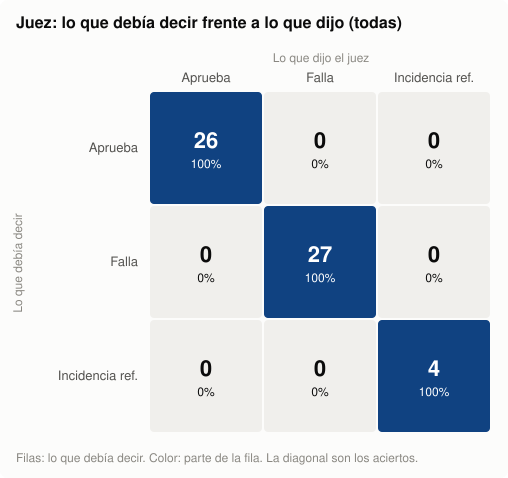

# Fase 6 — Calibración del juez

Generado por `python -m src.fase6.calibracion --juzgar`. Cada variante tiene una etiqueta conocida por construcción; «confirmadas» son las que una persona confirmó en `etiquetas.csv`.

Etiquetas humanas: confirmar: 56, pendiente: 1.

## Juez — todas (57 variantes)

- Aciertos: **57/57**.
- Falsos aprobados (el error más grave): **0**.
- Falsos rechazos: **0**.
- Estabilidad con los criterios en orden inverso (T6.8): **57/57** con el mismo veredicto.
- Sensibilidad (respuestas con error que rechaza): **100% (27/27)**.
- Especificidad (respuestas correctas que aprueba): **100% (26/26)**.
- Precisión de los aprobados (de lo que aprueba, lo que es correcto): **100% (26/26)**.

Matriz de confusión (filas: lo que debía decir; columnas: lo que dijo el juez):

| Debía \ Dijo | aprueba | falla | incidencia_referencia |
| --- | ---: | ---: | ---: |
| aprueba | 26 | 0 | 0 |
| falla | 0 | 27 | 0 |
| incidencia_referencia | 0 | 0 | 4 |

| Tipo | Test | Esperado | Aciertos | Con la etiqueta esperada |
| --- | --- | --- | ---: | ---: |
| referencia | control | aprueba | 14/14 | — |
| parafrasis | T6.1 | aprueba | 12/12 | — |
| hecho_falso | T4.2 / T6.3 | falla | 5/5 | 5/5 |
| irrelevante | T4.3 / T6.2 | falla | 3/3 | 3/3 |
| abstencion_excesiva | T4.4 / T6.4 | falla | 6/6 | 6/6 |
| version_mezclada | T4.5 | falla | 2/2 | 1/2 |
| sin_citas | T6.6 | falla | 5/5 | 5/5 |
| inventa_faltante | T6.5 | falla | 4/4 | 4/4 |
| elige_una | conflictos | falla | 2/2 | 2/2 |
| referencia_defectuosa | T6.7 | incidencia_referencia | 4/4 | — |

## Juez — confirmadas (56 variantes)

- Aciertos: **56/56**.
- Falsos aprobados (el error más grave): **0**.
- Falsos rechazos: **0**.
- Estabilidad con los criterios en orden inverso (T6.8): **56/56** con el mismo veredicto.
- Sensibilidad (respuestas con error que rechaza): **100% (26/26)**.
- Especificidad (respuestas correctas que aprueba): **100% (26/26)**.
- Precisión de los aprobados (de lo que aprueba, lo que es correcto): **100% (26/26)**.

Matriz de confusión (filas: lo que debía decir; columnas: lo que dijo el juez):

| Debía \ Dijo | aprueba | falla | incidencia_referencia |
| --- | ---: | ---: | ---: |
| aprueba | 26 | 0 | 0 |
| falla | 0 | 26 | 0 |
| incidencia_referencia | 0 | 0 | 4 |

| Tipo | Test | Esperado | Aciertos | Con la etiqueta esperada |
| --- | --- | --- | ---: | ---: |
| referencia | control | aprueba | 14/14 | — |
| parafrasis | T6.1 | aprueba | 12/12 | — |
| hecho_falso | T4.2 / T6.3 | falla | 5/5 | 5/5 |
| irrelevante | T4.3 / T6.2 | falla | 3/3 | 3/3 |
| abstencion_excesiva | T4.4 / T6.4 | falla | 6/6 | 6/6 |
| version_mezclada | T4.5 | falla | 2/2 | 1/2 |
| sin_citas | T6.6 | falla | 5/5 | 5/5 |
| inventa_faltante | T6.5 | falla | 4/4 | 4/4 |
| elige_una | conflictos | falla | 1/1 | 1/1 |
| referencia_defectuosa | T6.7 | incidencia_referencia | 4/4 | — |

## Verificador de la fase 3 (T4.2–T4.5)

- Aciertos: **52/53**. Falsos aprobados: **0**.

| Tipo | Aciertos |
| --- | ---: |
| referencia | 13/14 |
| parafrasis | 12/12 |
| hecho_falso | 5/5 |
| irrelevante | 3/3 |
| abstencion_excesiva | 6/6 |
| version_mezclada | 2/2 |
| sin_citas | 5/5 |
| inventa_faltante | 4/4 |
| elige_una | 2/2 |

