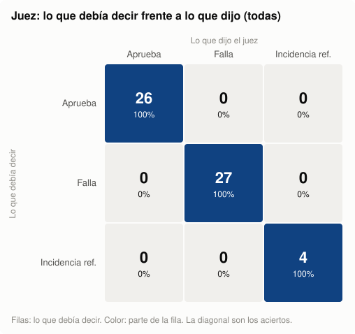

# Fase 6 — Evaluación: juez, calibración y diseño de la evaluación del modelo

Este documento es el protocolo de evaluación (el `evaluation_protocol.md` de la guía): cómo se mide si el modelo responde bien, cómo se comprobó que el juez es fiable y cómo se usaría para comparar B0, E1 y E2. **No se ha ejecutado ningún modelo**, así que no hay métricas de Qwen. Lo que sí está medido es el juez.

## 1. Las tres mediciones

Cada respuesta del modelo se evalúa en tres niveles, de lo más barato y objetivo a lo más caro:

| Medición | Pregunta | Cómo | Quién |
|---|---|---|---|
| 8.1 Llamada | ¿Llamó a la herramienta cuando debía, con el software y la versión correctos? Y si falta el software, ¿no llamó y preguntó? | Comparación exacta con `expected_tool` | Código |
| 8.2 Documentos | ¿Recibió los documentos correctos? | Los documentos se recalculan con el catálogo a partir de su llamada (no se toman de la predicción) y se comparan con `expected_document_ids` | Código |
| Citas | ¿Cada cita tiene formato válido, apunta a un documento recibido, está dentro del documento y evita líneas no citables? | La misma función del contrato de la fase 1 (`errores_de_citas`) | Código |
| 8.3 Respuesta | ¿Es correcta, completa, está respaldada y declara lo que falta? | Juicio por criterio, por afirmación y por cita | Juez (LLM) |

Los controles por código no deciden si una afirmación es verdadera: solo comprueban lo que se puede comprobar sin entender el texto. Esa parte es del juez.

## 2. El juez

**Configuración propia** (`LLM_JUEZ_*` en `.env`). En esta entrega es `gpt-6.1-sol` por la API de OpenAI: distinto del generador (Claude), para que no favorezca su propio estilo, y del verificador (`gpt-6-luna`), para no compartir sus puntos ciegos.

**Qué recibe** ([src/fase6/prompts/juez.md](../src/fase6/prompts/juez.md)): los documentos que recibió el modelo, el historial y la pregunta, las llamadas que hizo, las restricciones del caso (hueco o conflicto), la referencia con sus `answer_checks` numerados y la respuesta. **No sabe qué modelo la escribió.**

**Qué devuelve** (esquema en [src/fase6/judge.py](../src/fase6/judge.py)):
- por cada `answer_check`: `cumple`, `parcial` o `no_cumple`, con la evidencia;
- por cada afirmación técnica: si los documentos la respaldan, la contradicen o no la mencionan, y si su cita la sostiene;
- si la abstención es correcta, indebida (dice que no hay información cuando sí la hay) o faltante (inventa lo que falta);
- etiquetas de error para el diagnóstico (`afirmacion_sin_respaldo`, `version_incorrecta`, `abstencion_indebida`…);
- si la referencia contradice la fuente (incidencia de referencia).

**Qué no decide: la aprobación.** La decide el programa con una regla fija sobre la salida del juez. Una respuesta aprueba solo si:
- cumple todos los criterios;
- ninguna afirmación está sin respaldo ni contradicha;
- cada afirmación técnica tiene una cita que la respalda;
- la abstención no es indebida ni faltante.

Si el juez marca una incidencia de referencia, el caso no cuenta contra el modelo y va a revisión humana (T6.7).

**Principios que sigue el juez:**
- Juzga contenido, no redacción: una paráfrasis cumple.
- Otra cita válida también cuenta: no exige los mismos documentos que la referencia.
- Lo que falta no se cita: no exige una cita que «demuestre» una ausencia.
- Una cita que existe pero no dice lo afirmado falla.

## 3. Calibración del juez

Antes de usar un juez para medir un modelo, hay que medir el juez: si aprueba respuestas malas, las métricas del modelo no valen nada.

**Material** ([src/fase6/calibracion.py](../src/fase6/calibracion.py)):
- casos de `validation` y, para mezclar versiones, de `train` (validation no tiene versiones con contenido distinto). **Nunca de `test`.**
- de cada caso, varias respuestas cuyo veredicto correcto se conoce de antemano:

| Variante | Qué es | El juez debería | Test de la guía |
|---|---|---|---|
| referencia | La respuesta de referencia | aprobar | control |
| parafrasis | Lo mismo con otras palabras | aprobar | T6.1 |
| hecho_falso | Un valor o una negación cambiados, con la misma cita | rechazar | T4.2, T6.3 |
| irrelevante | Algo verdadero y citado que no contesta lo preguntado | rechazar | T4.3, T6.2 |
| abstencion_excesiva | «No está documentado», cuando sí lo está | rechazar | T4.4, T6.4 |
| version_mezclada | Un dato de una versión atribuido a otra | rechazar | T4.5 |
| sin_citas | La referencia sin ninguna cita | rechazar | T6.6 |
| inventa_faltante | Lo que no está documentado, inventado como hecho | rechazar | T6.5 |
| elige_una | Ante un conflicto, da por buena una fuente y calla la otra | rechazar | conflictos |
| referencia_defectuosa | La respuesta es correcta, pero se le da al juez una referencia equivocada | marcar incidencia sin penalizar | T6.7 |

- La referencia y la variante sin citas se construyen con código.
- El resto las escribe el corruptor (`LLM_CORRUPTOR_*`, con su propia configuración y su prompt en [src/fase6/prompts/corruptor.md](../src/fase6/prompts/corruptor.md)), que también explica qué cambió.
- Una persona confirma que cada variante tiene el error que dice tener (`python -m src.fase6.calibracion --revisar`). El reporte da los resultados con todas las variantes y solo con las confirmadas.

**Qué se mide:**
- la **matriz de confusión** (lo que debía decir frente a lo que dijo);
- la **sensibilidad**: de las respuestas con error, cuántas rechaza;
- la **especificidad**: de las correctas, cuántas aprueba;
- la **precisión de los aprobados**;
- los **falsos aprobados**, que son el error más grave, porque inflan las métricas del modelo;
- si da la **etiqueta de error** esperada;
- la **estabilidad**: si da el mismo veredicto con los criterios en orden inverso (T6.8).

Con el mismo material se prueba también al **verificador** de la fase 3 (T4.2–T4.5): ¿rechaza esas variantes como referencias?

## 4. Resultados de la calibración

15 casos (13 de `validation` y 2 de `train` para la mezcla de versiones) y 57 variantes. El juez, en su versión final, evaluó cada variante dos veces: con los criterios en el orden original y en orden inverso.



**Cómo leer la matriz:**
- Cada fila es lo que el juez **debía** decir; cada columna, lo que **dijo**.
- La diagonal son los aciertos. Fuera de ella están los errores, y el más grave es la celda «debía fallar / dijo aprueba», los **falsos aprobados**, porque harían parecer mejor al modelo de lo que es.
- El color indica qué parte de la fila cae en cada celda.

| Métrica | Juez | Qué significa |
|---|---:|---|
| Aciertos | **57/57** | Dio el veredicto correcto en todas las variantes |
| Sensibilidad | **100% (27/27)** | Rechazó todas las respuestas con error |
| Especificidad | **100% (26/26)** | Aprobó todas las respuestas correctas, incluidas las paráfrasis |
| Falsos aprobados | **0** | Ninguna respuesta mala pasó como buena |
| Incidencias de referencia detectadas | **4/4** | Cuando la referencia estaba mal, lo señaló sin castigar la respuesta |
| Estabilidad (T6.8) | **57/57** | El mismo veredicto con los criterios en orden inverso |
| Etiqueta de error esperada | 26/27 | Por ejemplo, en `version_mezclada` rechazó las dos, pero solo en una usó la etiqueta `version_incorrecta` |

**Qué se corrigió para llegar ahí.** La primera corrida dio 54/57, con tres falsos rechazos y ningún falso aprobado. Los tres eran respuestas correctas de `contradiccion` que citan las líneas del conflicto, marcadas como no citables. El contrato lo permite, precisamente para mostrar el conflicto, pero el prompt del juez no conocía esa excepción. Se agregó la regla y se volvió a juzgar todo, porque una calibración solo vale para el prompt con el que se hizo.

En el piloto también se ajustó el corruptor: una «paráfrasis» generalizaba («se usa siempre para cualquier error») y el juez la había aprobado. Ahora el corruptor tiene prohibido generalizar.

**Verificador de la fase 3 (T4.2–T4.5).**
- Rechazó todas las variantes con error: hecho falso, irrelevante, abstención excesiva, versión mezclada, sin citas, dato inventado y elección de una sola fuente. No tuvo ningún falso aprobado.
- Su único fallo (52/53) fue rechazar una referencia que él mismo había aprobado en la fase 3, por una cita «algo indirecta». Es variabilidad del verificador entre una ejecución y otra, no un error de las variantes.

**Límites de este resultado:**
- **Son 57 variantes de 15 casos.** Un 100% con esta muestra dice que el juez detecta estos tipos de error, no que nunca se equivoque. Con más casos aparecerán fallos, y el reporte está para encontrarlos.
- **Los errores son fabricados:** uno por variante y limpios. Los errores reales de un modelo pueden ser más sutiles o venir mezclados. Por eso la evaluación incluye una revisión humana de respuestas reales (sección 5).
- **Confirmación humana:** una persona revisó las variantes con `--revisar` y confirmó 56 de 57. No descartó ninguna, y una quedó sin revisar (`validation-contradiccion-007__elige_una`). Con solo las confirmadas, el juez también acierta 56/56.
- **El juez usó `gpt-6.1-sol`**, primero por la API de OpenAI y después, cuando se acabaron los créditos, por Codex, con el mismo modelo. Cambiar de modelo obliga a recalibrar.


## 5. Diseño de la evaluación del modelo

Con el juez calibrado, así se evaluarían B0, E1 y E2:

1. **Inferencia.** Cada modelo recibe las entradas de `data/fase5/entradas_validation.jsonl`: solo el sistema, el historial y la pregunta. Un **orquestador**, el programa que le pasa la pregunta al modelo, ejecuta cada llamada a `obtener_documentacion` que el modelo pida (hasta 2), le devuelve el resultado y guarda la respuesta final. El modelo solo genera texto; ejecutar la herramienta es trabajo del orquestador. Se guarda una línea por caso, `{"id", "mensajes"}`, en `predicciones_validation.jsonl`, con la misma configuración de generación para los tres (fase 5).
2. **Evaluación:**

   ```bash
   python -m src.fase6.evaluar --predicciones runs/E1/predicciones_validation.jsonl --experimento E1
   ```

   Aplica los controles por código y el juez, y escribe `data/fase6/evaluaciones/E1/validation/judgments.jsonl` (cada juicio, con sus etiquetas y su evidencia) y `metricas.json`, más el reporte en `reports/fase6/`.
3. **Métricas**, siempre con numerador y denominador, en total y por situación:

| Métrica | Cálculo |
|---|---|
| Llamada correcta (8.1) | Casos con la llamada esperada / casos |
| Documentos correctos (8.2) | Casos que recibieron los documentos esperados / casos con llamada esperada |
| Citas válidas | Respuestas sin errores de citas / respuestas que deben citar |
| Corrección y completitud | Criterios cumplidos / criterios evaluados |
| Respaldo de citas | Afirmaciones citadas cuya cita las sostiene / afirmaciones citadas («no aplica» si no hay, nunca 100%) |
| Cobertura de citas | Afirmaciones técnicas con una cita que las sostiene / afirmaciones técnicas |
| Abstención correcta | Casos sin evidencia que declaran el límite sin inventar / casos sin evidencia |
| Abstención indebida | Casos respondibles donde dice que no hay información / casos respondibles |
| Respuesta parcial correcta | Casos de evidencia parcial aprobados / casos de evidencia parcial |
| Aprobados | Casos que aprueban el juez, la llamada y las citas / casos |

4. **Comparación y selección** (fase 5, sección 6):
   - se comparan B0, E1 y E2 en `validation`, por situación;
   - se elige la configuración con mayor corrección y completitud sin empeorar el respaldo de citas ni la abstención correcta respecto de B0, con los márgenes fijados antes de mirar resultados;
   - las etiquetas de error de `judgments.jsonl` dicen qué falla y alimentan la tabla de diagnóstico de la guía. Por ejemplo, muchas `abstencion_indebida` → revisar la mezcla de situaciones; muchas `version_incorrecta` → revisar los casos de versiones.
5. **Revisión humana de una muestra:**
   - hasta 30 respuestas: 10 de casos con evidencia suficiente, 10 con evidencia insuficiente y 10 con evidencia parcial, al azar dentro de cada grupo;
   - se registran la utilidad, la claridad y los desacuerdos con el juez;
   - sirve para vigilar al juez, no para estimar una frecuencia global.
6. **`test`, una sola vez,** con la configuración elegida: `--conjunto test --final`. Sin `--final`, el script se niega a evaluarlo.
7. **Cuándo hay que recalibrar el juez:**
   - si cambia su modelo o su prompt;
   - si la revisión humana muestra desacuerdos sistemáticos.

   La caché lo hace visible: cambiar el prompt cambia la clave de cada llamada.

## 6. Extensión: otra forma de recuperar la documentación

En esta versión, la recuperación es deliberadamente simple: `obtener_documentacion(software, version)` es un filtro que devuelve **documentos completos**. Por eso la medición 8.2 es una comparación exacta de IDs.

El pipeline está pensado para que una recuperación más compleja se pueda implementar y evaluar con las mismas piezas: un buscador semántico (embeddings, *reranker*) o una herramienta que use un LLM para elegir los fragmentos. Qué cambiaría:

| Pieza | Hoy | Con un buscador por fragmentos |
|---|---|---|
| Herramienta (fase 1) | Filtro por software y versión, documentos completos | `buscar(consulta, software?, version?)` → fragmentos con su documento y rango de líneas. Las secciones de la fase 0 ya son una unidad de fragmento natural: tienen límites de línea y estado de uso |
| Llamada (8.1) | Argumentos exactos | Ya no hay una consulta «correcta» única. Se evalúa por su resultado (8.2) y, si hace falta, el juez valora si la consulta es razonable |
| Recuperación (8.2) | IDs de documentos idénticos | Métricas de recuperación sobre la evidencia esperada, que ya está en `procedencia` (documento, líneas y hash). Un fragmento acierta si se solapa con las líneas de la evidencia: *recall@k*, precisión y MRR. En `contradiccion` se exige recuperar las dos fuentes. En `sin_evidencia`, que no aparezca un fragmento que parezca responder |
| Citas | `[documento:Linicio-Lfin]` sobre documentos recibidos | Sin cambios: los fragmentos conservan su documento y sus números de línea, así que el formato de cita y `errores_de_citas` siguen sirviendo |
| Juez (8.3) | Recibe los documentos completos | Recibe los fragmentos recuperados. `prompt_juez` ya renderiza «lo que recibió el modelo», sea lo que sea. Su calibración se repite, con variantes que citen fragmentos no recuperados |
| Datos (fases 3 y 4) | Conversaciones con documentos completos | Se regeneran con la salida del nuevo buscador. El contrato, los controles y la deduplicación no cambian |

**Por qué el diseño lo permite.** Lo que se evalúa nunca depende de la forma de la recuperación:
- la evidencia esperada está guardada a nivel de línea (`procedencia`, con hash);
- las citas se resuelven contra lo que el modelo recibió;
- el juez solo ve eso mismo.

Cambiar el buscador cambia qué recibe el modelo y cómo se puntúa la recuperación, no cómo se juzga la respuesta.

## 7. Salidas

| Archivo | Contenido |
|---|---|
| `src/fase6/prompts/juez.md`, `corruptor.md` | Prompts del juez y del corruptor |
| `data/fase6/calibracion/variantes.jsonl` | Las variantes de calibración, con su tipo, el veredicto esperado y qué cambió |
| `data/fase6/calibracion/etiquetas.csv` | La confirmación humana de cada variante |
| `data/fase6/calibracion/juicios.jsonl`, `resumen.json` | Lo que dijo el juez de cada variante y el resumen |
| `reports/fase6/calibracion.md` | Matriz de confusión, sensibilidad, especificidad, falsos aprobados, estabilidad y resultados del verificador |
| `data/fase6/cache/` | Respuestas del corruptor, del juez y del verificador (para `--solo-cache`) |
| `data/fase6/evaluaciones/<experimento>/<conjunto>/` | Con predicciones reales: `judgments.jsonl` y `metricas.json` |

## 8. Tests

`src/tests/test_fase6.py`, con un juez falso:
- **La regla de aprobación:**
  - un criterio parcial, una afirmación contradicha, una afirmación sin cita que la respalde o una abstención indebida hacen fallar;
  - una incidencia de referencia no penaliza;
  - una oferta de ayuda no necesita cita.
- **Los controles por código:**
  - la referencia como predicción pasa los controles;
  - otra versión falla la llamada;
  - el texto `null` cuenta como nulo;
  - llamar cuando falta el software es un error;
  - citar un documento no recibido es un error.
- **El prompt del juez:** no revela el modelo, y el orden inverso conserva el número de cada criterio.
- **Las métricas:**
  - numerador y denominador correctos;
  - «no aplica» cuando no hay citas;
  - las incidencias quedan fuera.
- **La evaluación de punta a punta:** con caché y `--solo-cache`.
- **La calibración:**
  - es determinista y no usa `test`;
  - la variante sin citas no tiene ninguna y el contrato la rechaza.

## 9. Reproducibilidad

```bash
python -m src.fase6.calibracion --juzgar --estabilidad --verificador --solo-cache
```

Reproduce la calibración con las respuestas guardadas, sin llamar a ningún LLM ni necesitar API keys.
